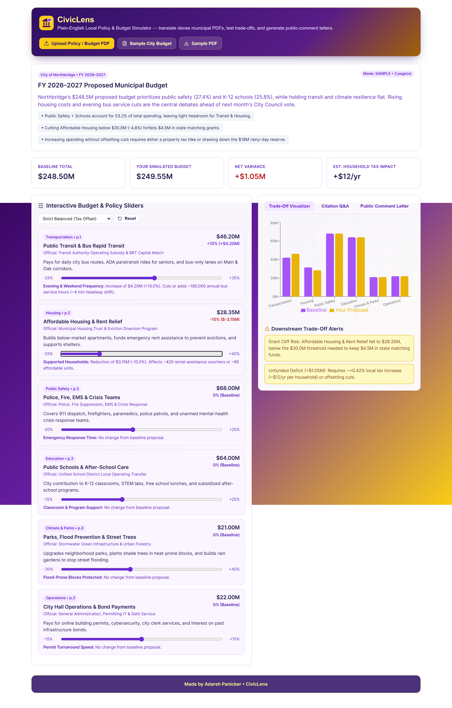
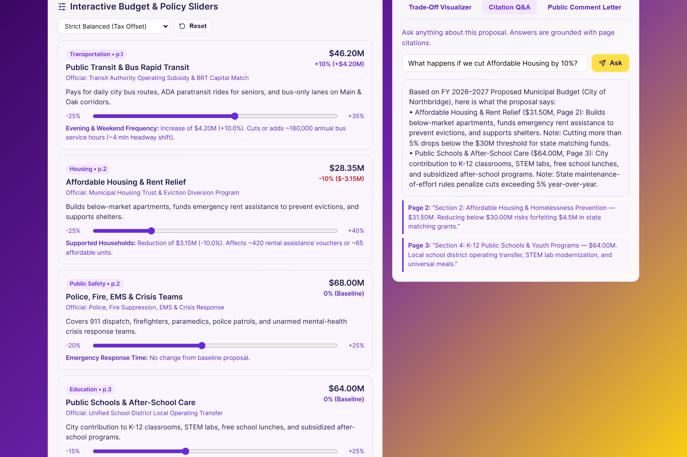
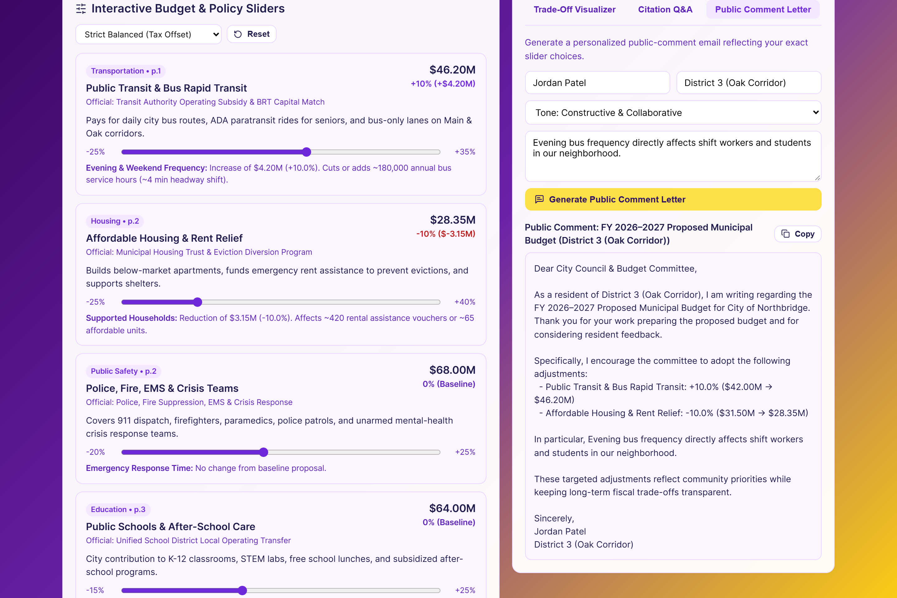

# CivicLens — Plain-English Local Policy & Budget Simulator

Built for the **Creators AI Winter Challenge** by **Adarsh Panicker**.

CivicLens transforms dense municipal budget PDFs, zoning bills, and school board proposals into an interactive, plain-English decision simulator. Residents can explore line items with page citations, test budget trade-offs with live sliders, inspect downstream fiscal and grant-cliff warnings, ask citation-grounded questions, and generate personalized public-comment letters.

## Screenshots

### Interactive Budget Simulator & Trade-Off Visualizer


### Citation-Grounded Q&A


### Public Comment Letter Generator


## Features
- **PDF Ingestion & Structured Extraction:** Upload any municipal budget or policy PDF (parsed page-by-page with PyMuPDF) or explore the built-in *City of Northbridge FY 2026–2027* sample budget.
- **Plain-English Line-Item Explorer:** Translates bureaucratic line items into clear summaries with page citations and real-world impact metrics.
- **Deterministic Trade-Off Simulator:** Adjust department sliders to see live Recharts comparisons, net variance, estimated annual household property tax impact, rainy-day reserve drawdown, and grant-cliff warnings.
- **Citation-Grounded Q&A:** Ask questions about the proposal and receive answers backed by exact page-number excerpts.
- **Public Comment Letter Generator:** Generate tailored, copy-ready letters to City Council reflecting your exact slider adjustments and neighborhood priorities.

## Tech Stack
- **Backend:** Python, FastAPI, PyMuPDF (`fitz`), Pydantic, HTTPX (supports `GEMINI_API_KEY` or `OPENAI_API_KEY` structured JSON outputs with a built-in deterministic/heuristic fallback).
- **Frontend:** React, TypeScript, Vite, Recharts, Lucide Icons.

## Quick Start

### 1. Backend
```bash
cd backend
python -m venv .venv
.venv\Scripts\activate   # Windows
pip install -r requirements.txt
# Optional: copy .env.example to .env and add GEMINI_API_KEY or OPENAI_API_KEY
uvicorn app.main:app --reload --port 8000
```

### 2. Frontend
```bash
cd frontend
npm install
npm run dev
```
Open `http://localhost:5173`.
